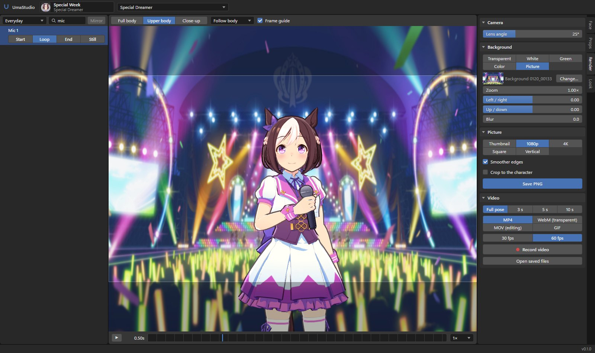

# UmaStudio

Pose Uma Musume characters, give them props and backgrounds, and save PNGs or videos.

UmaStudio reads the files of your installed game (Global or Japanese Steam version). The game can stay closed,
nothing in the game folder is changed, and nothing is sent anywhere: the app runs on your PC only.



Website and guide: https://umastudio.byharuki.dev

## Download

1. Get `UmaStudio-<version>.zip` from [this fork's Releases](https://github.com/daftuyda/UmaStudio/releases/latest).
2. Extract it anywhere and run `UmaStudio/UmaStudio.exe`.

See the [0.1.3 change summary](docs/releases/0.1.3.md). The original project is
[oHaruki/UmaStudio](https://github.com/oHaruki/UmaStudio).

You need:

- Windows 10 or 11
- Uma Musume installed through Steam, started at least once so its data is downloaded
- For video export only: [ffmpeg](https://ffmpeg.org/download.html), either on PATH or `ffmpeg.exe` next to `UmaStudio.exe`

The first start takes a bit while it reads the game's file list. Every character is converted
the first time you open her, after that she loads from the cache.

## How to use it

- **Choose an Uma** (top left), then the outfit next to it. The picker has three tabs: the main
  Umas, their **Chibi** versions, and the **Background Umas** from races and events.
- **Poses** (left): pick a category, search in plain English ("arms crossed", "waving", "phone").
  Cut-ins play all numbered shots in order, repeating the complete sequence. Start/loop/end
  sets play one pass of each part. **Play all** restores the full sequence after selecting an
  individual shot; still poses and alternative reactions remain separate. The timeline and video
  duration cover the whole sequence. Chibis have their own category.
- **Face**: **Follow animation** uses the matching pose or shot's eye, eyebrow, mouth and gaze
  animation when downloaded. Selecting a manual expression turns this off. Poses without a
  matching facial clip keep the manual expression. Expressions, face parts and "Look at camera"
  remain available.
- **Animation camera** (above the viewport): use the shot's camera movement, angle and zoom,
  with its character placement. It stays synchronized during Play all, scrubbing, PNG captures
  and videos. Turning it off restores your manual view. Shots without a downloaded camera track
  show **No camera track** and use the manual camera; the option stays selected for later shots.
- **Pose**: show the joints, click one and turn it with the rings. Changes sit on top of the
  motion, so pictures, videos and exports keep them. Hold **Shift** while dragging for fine
  adjustments; playback pauses until you release the ring. **Reset joint** and **Reset all**
  restore the underlying animation pose. Poses can be saved and loaded.
- **Animate**: create a custom animation from a neutral pose. Move the bottom playhead,
  adjust joints/fingers in **Pose**, choose an expression in **Face**, then click
  **Add / update keyframe**. Character movement is available in the Animate panel.
  Click a diamond to select a full-pose keyframe; copy/paste, move it by its time field,
  delete it, or choose **Smooth**, **Linear**, or **Hold** for its outgoing transition.
  **Undo edit** restores project changes. Playback can loop or stop on the final pose.
  **Apply project settings** sets the name, duration (up to 120 seconds), frame rate
  (30 or 60 fps), and looping. Copy the first keyframe to the end for a seamless loop.
  **Save project** writes an editable `.umaanim` file; **Open** loads it, and
  **Resume project** returns to the local draft after browsing game animations or restarting.
  Seeking or starting playback clears changes that have not been added to a keyframe.
  Hair/clothing physics run over the authored body pose. The Render tab exports the active
  animation as video or animated GLB. Projects reuse compatible skeleton names across outfits;
  full-size and chibi projects remain separate. Chibi expressions change as held tiles, and
  animated chibi face tiles are visible in video but are not carried into GLB.
  **Import Unity .anim** loads Unity Humanoid animations onto a full-size Uma. Importing uses
  a locally installed Unity Editor (tested with 2022.3), detected automatically from Unity Hub;
  use **Unity location** for other installations. The converter works in its own private project
  and leaves the original animation untouched. Body/finger motion is retargeted to the selected
  character and sampled at 60 fps. Existing `.anim` files with generic/legacy bone curves,
  FBX/BVH, prop animation, and imported facial controls are not supported by this importer.
  Imported motion stays underneath your correction keyframes, so joint changes and expressions
  can be edited without replacing the dance. Save the resulting `.umaanim` project to embed the
  converted motion; reopening, playing, editing and exporting it needs no Unity installation.
  Reimport for the best fit when changing to a character with different proportions.
  The first conversion may take a few minutes; subsequent imports for the same skeleton are cached.
  Camera/prop keyframes and foot locking are not included yet.
- **Props**: one of the game's hand props, or your own picture as a card or a box. A picture can
  also go on a game prop. Drag the handles in the view to place it.
  **Load animation props automatically** reads supported game associations and cut-in
  attachments, including shot visibility and paired prop animations. For other motions, add
  and position props manually, then choose **Remember setup**. That setup loads when the
  animation is selected again; **Use detected props** removes the custom setup. Unsupported
  or undownloaded props are reported in the panel. Unrelated manual props stay in the scene.
- **Render**: lens, background (transparent, color, a game background or your own picture),
  PNG size (presets or your own), video (MP4, transparent WebM, MOV for editing, transparent GIF,
  or numbered PNG frames), and **Export for Blender**: her mesh, skeleton, textures and props as
  a .glb, in the current pose or with the motion baked in.
  Video exports show speed, elapsed time and an estimate of time remaining. Cancel works
  during rendering and encoding and removes the unfinished output. Frames use lossless
  compressed transfer, and GIFs stream without keeping the whole animation in memory.
- **Look**: light, shadow size, outlines, hair and cloth physics. **Body & clothing
  collisions** keeps simulated hair, ties and other loose pieces outside the posed body
  surface; **Collision clearance** adjusts the gap. It supplements the game's spring
  colliders and is enabled by default. Contact corrections are smoothed separately from
  the spring simulation to avoid twitching at clothing seams. Loose garments do not collide with each other,
  so some intersections can remain in extreme poses.
- **Settings** (top right): switch between **Global** and **Japan (JP)**. Steam installations
  are detected automatically, or you can choose the install folder and downloaded data folder
  separately. Each region remembers its folders. Applying settings reloads the viewer and clears
  the current scene, so save your work first.

JP Steam uses `UmamusumePrettyDerby_Jpn\UmamusumePrettyDerby_Jpn_Data\Persistent`.
The data folder contains `meta`, `master`, and `dat`. Older JP layouts with `umamusume_Data`
and data in `AppData\LocalLow\Cygames\Umamusume` can also be selected manually.
Protected JP builds need a compatible Global installation as well: UmaStudio uses its database
reader to open the selected JP data. It does not substitute Global assets for JP assets.
When a JP build protects its native physics library, UmaStudio also uses the installed Global
physics library with the JP character's own skeleton, spring settings and collision data.
If neither library can load, the Look panel explains which installation is needed.
Names display in English in either region. JP's own Latin-script character names cover JP-only
characters; the installed Global database supplies other translated labels when available.
Untranslated outfits, songs and background characters use an English label with their ID.
This changes display names only; JP assets and existing converted caches remain in use.

Mouse: left drag turns the camera, right drag pans, wheel zooms.
Keys: Space plays/pauses, W / E / R switch the prop handles, Delete removes a prop, Esc lets go,
Ctrl+Z undoes a joint change.

## Where files go

| What | Where |
| --- | --- |
| Saved PNGs and videos | `Pictures\UmaStudio\renders` |
| Editable animation projects | `Pictures\UmaStudio\animations` |
| Converted Humanoid clips, private Unity project and import log | `%LOCALAPPDATA%\UmaStudio\animation-import` |
| Your pictures (for props and backgrounds) | `Pictures\UmaStudio\images` |
| Converted characters, props, backgrounds | `Pictures\UmaStudio\viewer-cache\<region-and-source>` |
| Game folders and selected region | `%LOCALAPPDATA%\UmaStudio\game.json` |
| Game file list caches | `%LOCALAPPDATA%\UmaStudio\profiles\<region-and-source>` |
| Log | `%LOCALAPPDATA%\UmaStudio\viewer.log` |

Deleting `viewer-cache` is safe, things are converted again when needed.
Global and JP assets have separate caches, including when you choose a different data folder.
Existing single-folder settings are retained as the Global profile.
Animation companions are cached on disk, repeated clip requests share work, and model textures
load concurrently. Prop and background previews are prepared when needed rather than converting
the entire catalog at startup.

## Run from source

Python 3.12:

```
cd viewer
pip install -r requirements.txt
python serve.py
```

It opens http://127.0.0.1:27620 in your browser. `viewer\build_exe.ps1` builds
`viewer\dist\UmaStudio\UmaStudio.exe` in its own venv.
It also creates `viewer\dist\UmaStudio-<version>.zip` and a `.zip.sha256` checksum.

## Automated builds and releases

The **Windows build and release** GitHub Action runs Python and JavaScript tests and
builds a Windows ZIP on pull requests to `main`, pushes to `main`, and manual runs.
Download the ZIP from the run's artifacts; these are retained for 14 days.
The tests do not require an installed game. Local builds can run the same checks with
`.\viewer\build_exe.ps1 -RunTests` (Python 3.13 and Node.js 24).

To publish a release, update `VERSION` in `viewer/serve.py`, add
`docs/releases/<version>.md`, and commit and push the changes to `main`.
After the build and tests pass, the workflow creates the matching tag (for example,
`v0.1.3`) on that exact tested commit and publishes the ZIP, checksum and release notes.
You do not need to create or push the tag yourself.

Existing published versions are left unchanged. If a tag already points to a different
commit, the workflow skips publication; increase `VERSION` for the next release.
An interrupted draft upload can be resumed by rerunning the same workflow.
Manually pushed version tags are also supported and must match the app version.
Pull-request and manual workflow runs only produce build artifacts.
GitHub Actions must be enabled for the fork. No personal access token is needed.
Tag creation and publication happen in the same run.

## Help

- Discord: https://discord.gg/f4QZNag9Hv
- Support the project: https://ko-fi.com/harukidev

## Notes

UmaStudio is a fan project and not affiliated with Cygames. It ships no game files: everything
it shows comes from your own install. Characters and art belong to their owners.

Licensed under GPL-3.0 (see [LICENSE](LICENSE)). Bundles [three.js](https://threejs.org) (MIT, `viewer/static/vendor/three-LICENSE.txt`).
